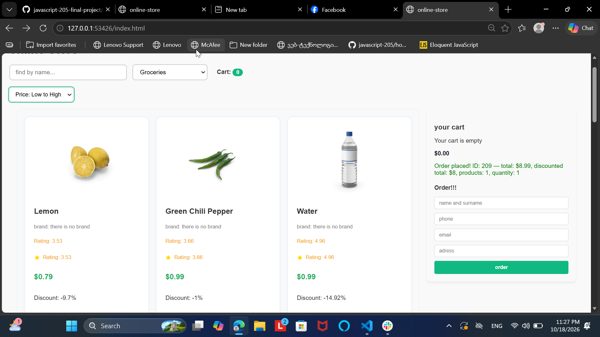

# E-Commerce Web Application (Online Store)
https://anano2244.github.io/online-store/ this is link from github and bonus x6

Here is the architecture diagram illustrating how the client-side application interacts with the API and database:

## 📌 Project Overview
This project is a dynamic, single-page e-commerce web application built with Vanilla JavaScript, HTML5, and CSS3. It simulates a fully functional online shop that fetches real-time data from an external REST API (DummyJSON). The application allows users to browse products with pagination, search by keywords, filter items by category, sort products by price, view detailed product information, and manage a persistent shopping cart using localStorage.

---

## 📸 Application Screenshot

---

## 🚀 How to Run
1. Clone or download this project repository.
2. Open the project directory in *Visual Studio Code*.
3. Install and use the *Live Server* extension (right-click index.html and select *Open with Live Server*).
4. Access the application in your browser at http://127.0.0.1:5500.

---

## ✨ Features
* *Dynamic Product Catalog:* Fetches products asynchronously from the API and renders them dynamically in grid layout.
* *Pagination:* Supports multi-page navigation with limits and skips (limit=10, skip=...).
* *Category Filtering & Search:* Real-time search by input text and category selection dropdown.
* *Product Sorting:* Sorts products dynamically by price (ascending/descending).
* *Detailed Product View:* Dedicated product detail page (product.html) displaying full item specs and images.
* *Persistent Shopping Cart:* Fully interactive cart saved in localStorage. Items remain saved upon page reload.
* *Cart Badge Indicator:* Real-time updates for total item count in the header navigation (.cart-count-badge).
* *Robust Error Handling:* Custom try/catch wrappers with showLoadError() fallback UI offering a "Try Again" mechanism for network or HTTP 404 failures.

---

## 🔌 API Endpoints
The application communicates with the *DummyJSON REST API* using asynchronous JavaScript (fetch`/async/await`). The endpoints utilized are:

1. *Get All Products (Paginated):*  
   GET https://dummyjson.com/products?limit=10&skip=0  
   Used to load the default catalog grid with page navigation.

2. *Search Products:*  
   GET https://dummyjson.com/products/search?q={query}  
   Used for live filtering based on the search input field.

3. *Get Product Categories:*  
   GET https://dummyjson.com/products/categories  
   Used to dynamically populate the category filter dropdown.

4. *Get Products by Category:*  
   GET https://dummyjson.com/products/category/{category}  
   Used when filtering items by a specific category.

5. *Get Single Product:*  
   GET https://dummyjson.com/products/{id}  
   *Used on product.html to display individual product details.*

---

## 📈 What I Would Improve
* *Backend Integration for Checkout:* Replace mocked cart posting with a real authentication and payment gateway integration.
* *User Accounts:* Add user login, registration, and persistent user profile order history.
* *Enhanced UI/UX:* Add toast notifications when items are added to the cart and skeleton loaders during network latency.
* *Mobile Responsiveness:* Refine grid layouts and drawer navigation specifically for smaller screens.

---

## 🤖 AI Use Disclosure
AI tools (Command Code / Claude / GPT) were utilized during development for:
* *Debugging & Refactoring:* Assistance in analyzing asynchronous control flow, identifying missing DOM selectors (like .cart-count-badge), and structuring try/catch error handlers.
* *Code Structuring:* Guidance on modularizing code into app.js, api.js, and storage.js.
* *Documentation & Review:* Assisting in formatting technical documentation (README.md) and generating AI task execution logs (AI_LOG.md).
თქვენ გაგზავნეთ
## 📈 What I Would Improve
* *Backend Integration for Checkout:* Replace mocked cart posting with a real authentication and payment gateway integration.
* *User Accounts & Orders:* Add user login, registration, and persistent user profile order history.
* *Wishlist / Favorites:* Allow users to save favorite products to a dedicated Wishlist using localStorage.
* *Dark Mode Toggle:* Implement a theme switcher between Light and Dark mode for better accessibility.
* *Skeleton Loaders:* Replace basic text loaders with smooth skeleton screen animations during API calls.
* *Enhanced Mobile UI:* Refine grid layouts and side navigation specifically tailored for small screen devices.

## 📌 Project Overview
This project is a dynamic, single-page e-commerce web application built with Vanilla JavaScript, HTML5, and CSS3. It simulates a fully functional online shop that fetches real-time data from an external REST API (DummyJSON). The application allows users to browse products with pagination, search by keywords, filter items by category, sort products by price, view detailed product information, and manage a persistent shopping cart using localStorage.

---

## 📸 Application Screenshot

---

## 🚀 How to Run
1. Clone or download this project repository.
2. Open the project directory in *Visual Studio Code*.
3. Install and use the *Live Server* extension (right-click index.html and select *Open with Live Server*).
4. Access the application in your browser at http://127.0.0.1:5500.

---

## ✨ Features
* *Dynamic Product Catalog:* Fetches products asynchronously from the API and renders them dynamically in grid layout.
* *Pagination:* Supports multi-page navigation with limits and skips (limit=12, skip=...).
* *Category Filtering & Search:* Real-time search by input text and category selection dropdown.
* *Product Sorting:* Sorts products dynamically by price (ascending/descending).
* *Detailed Product View:* Dedicated product detail page (product.html) displaying full item specs and images.
* *Persistent Shopping Cart:* Fully interactive cart saved in localStorage. Items remain saved upon page reload.
* *Cart Badge Indicator:* Real-time updates for total item count in the header navigation (.cart-count-badge).
* *Robust Error Handling:* Custom try/catch wrappers with showLoadError() fallback UI offering a "Try Again" mechanism for network or HTTP 404 failures.

---

## 🔌 API Endpoints
The application communicates with the *DummyJSON REST API* using asynchronous JavaScript (fetch+/async/await``). The endpoints utilized are:

1. *Get All Products (Paginated):*  
   GET https://dummyjson.com/products?limit=10&skip=0  
   Used to load the default catalog grid with page navigation.

2. *Search Products:*  
   GET https://dummyjson.com/products/search?q={query}  
   Used for live filtering based on the search input field.

3. *Get Product Categories:*  
   GET https://dummyjson.com/products/categories  
   Used to dynamically populate the category filter dropdown.

4. *Get Products by Category:*  
   GET https://dummyjson.com/products/category/{category}  
   Used when filtering items by a specific category.

5. *Get Single Product:*  
   GET https://dummyjson.com/products/{id}  
   *Used on product.html to display individual product details.*

---

## 📈 What I Would Improve
* *Backend Integration for Checkout:* Replace mocked cart posting with a real authentication and payment gateway integration.
* *User Accounts:* Add user login, registration, and persistent user profile order history.
* *Enhanced UI/UX:* Add toast notifications when items are added to the cart and skeleton loaders during network latency.
* *Mobile Responsiveness:* Refine grid layouts and drawer navigation specifically for smaller screens.

---

## 🤖 AI Use Disclosure
AI tools (Command Code / Claude / GPT) were utilized during development for:
* *Debugging & Refactoring:* Assistance in analyzing asynchronous control flow, identifying missing DOM selectors (like .cart-count-badge), and structuring try/catch error handlers.
* *Code Structuring:* Guidance on modularizing code into app.js, api.js, and storage.js.
* *Documentation & Review:* Assisting in formatting technical documentation (README.md) and generating AI task execution logs (AI_LOG.md).

## 📈 What I Would Improve
* *Backend Integration for Checkout:* Replace mocked cart posting with a real authentication and payment gateway integration.
* *User Accounts & Orders:* Add user login, registration, and persistent user profile order history.
* *Wishlist / Favorites:* Allow users to save favorite products to a dedicated Wishlist using localStorage.
* *Dark Mode Toggle:* Implement a theme switcher between Light and Dark mode for better accessibility.
* *Skeleton Loaders:* Replace basic text loaders with smooth skeleton screen animations during API calls.
* *Enhanced Mobile UI:* Refine grid layouts and side navigation specifically tailored for small screen devices.